  

  
  
  

**English** · [日本語](README.ja.md)

## 👋 About me

- 🏢 Engineering Manager and Forward Deployed Engineer (FDE) at **PKSHA Technology**
- 🪜 Previously Executive Officer at PKSHA Communication, leading software engineering across its AI SaaS products. PKSHA Communication and PKSHA Workplace were merged into PKSHA Technology in July 2025
- 🛤️ In software since 2009 — systems integration → mobile games → IoT & edge AI → AI SaaS, as an engineer, lead engineer and engineering manager
- 🎤 Spoke about building generative AI into SaaS at [Microsoft Build 2023](https://speakerdeck.com/pkshadeck/azure-openai-servicewohuo-yong-sita-ai-saaspurodakutokai-fa-noshi-jian) and [SaaS on AWS 2023](https://speakerdeck.com/pkshadeck/saasniokerusheng-cheng-ai-noshi-zhuang-tosonowei-lai)
- 🤖 Hands-on with agentic development: Claude Code, Codex, Cursor and Devin
- 🏡 Based in Saitama, Japan. Father of three
- ✍️ Writing (in Japanese) at [blog.taross-f.dev](https://blog.taross-f.dev/)

## 🔵 Connecting the Dots — open an issue. There is no other setup.

> *"You can't connect the dots looking forward; you can only connect them looking backwards."* — Steve Jobs

SI, mobile games, IoT and edge AI, AI SaaS: looking back, those dots connect into one line.
From here on, the job is to place the next dots. **So — where would you put the next one?**

Write a point on the future grid in an issue and the line is drawn from the last dot to yours.
The moment the line touches itself — an earlier dot, an earlier segment, or *now* — the dots
have connected: the chapter is closed into the hall of fame and the next dot starts a fresh line from now.

<!-- BOARD:START -->

**[▶ Place a dot](https://github.com/taross-f/taross-f/issues/new?template=play.yml)** — open an issue with two integers: x (1–12) and y (1–9).

| Chapter | Dots | Best ever |
|---:|---:|---:|
| 1 | 0 | 0 |
<!-- BOARD:END -->

### How to play

1. **[Open an issue](https://github.com/taross-f/taross-f/issues/new?template=play.yml)** — the `play` label is applied for you
2. Write **two integers**: x (1–12) and y (1–9). `7 3`, `7,3` and `(7, 3)` all work
3. Within a minute GitHub Actions draws the line, updates the board and this README, and replies on your issue

| Rule | |
|:--|:--|
| Grid | x = 1–12 (left to right, away from *now*), y = 1–9 (bottom to top) |
| Line | Always drawn from the previous dot of the chapter to yours. The first one starts at *now* |
| Connected | Your stretch of line touches anything already drawn in the chapter. The chapter closes |
| Score | Dots in a chapter when it connects. The longer the line runs without touching itself, the better |
| Cooldown | One dot per player every 10 minutes |

Nobody can see how the dots will connect until somebody places the one that does.

## 🚀 Career

  

## ⚡ Tech stack

  

---

